# Guía de usuario de ReservaLocal

## Acceso y registro

### Entrar por primera vez

Al abrir la web verás una pantalla de login dividida: a la izquierda el nombre "Reserva Local" en grande, a la derecha el formulario para entrar.

Si ya tienes cuenta, introduce tu email y contraseña y pulsa **Entrar**.

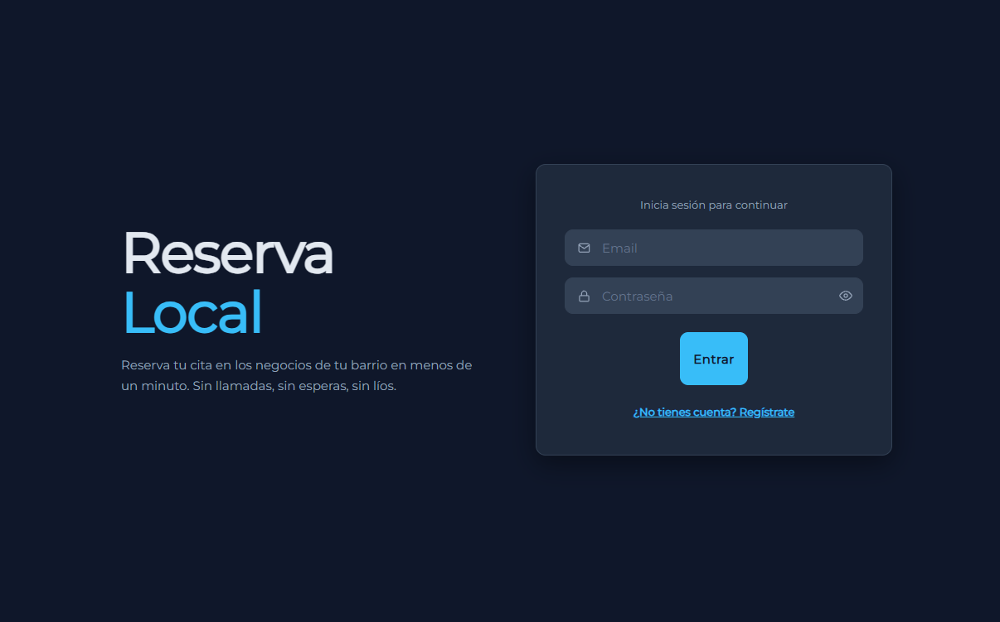

### Cuentas para probar la web

| Rol | Email | Contraseña | Negocio |
|---|---|---|---|
| Administrador | `admin@reservalocal.com` | `Admin123.` | Peluquería Jon |
| Administrador | `admin2@reservalocal.com` | `Admin123.` | Barbería Central |
| Cliente | `cliente@reservalocal.com` | `Cliente123!` | — |

### Crear una cuenta nueva

Pulsa el enlace **"¿No tienes cuenta? Regístrate"** debajo del botón Entrar. Aparecen campos adicionales:

- **Nombre** y **apellidos** (obligatorios)
- **Email**
- **Contraseña** (mínimo 6 caracteres) y confirmación
- **Código de administrador** (opcional)
- **Nombre de tu negocio** (opcional, solo si usas código)

Al registrarte sin código te creas como **cliente**. Si introduces un código válido y el nombre de tu negocio, te creas como **administrador** de ese negocio y puedes gestionarlo desde dentro.

El código maestro para pruebas de registro es `1234`. En un entorno real, los códigos los emitiría ReservaLocal cuando un nuevo negocio contactara con la plataforma.

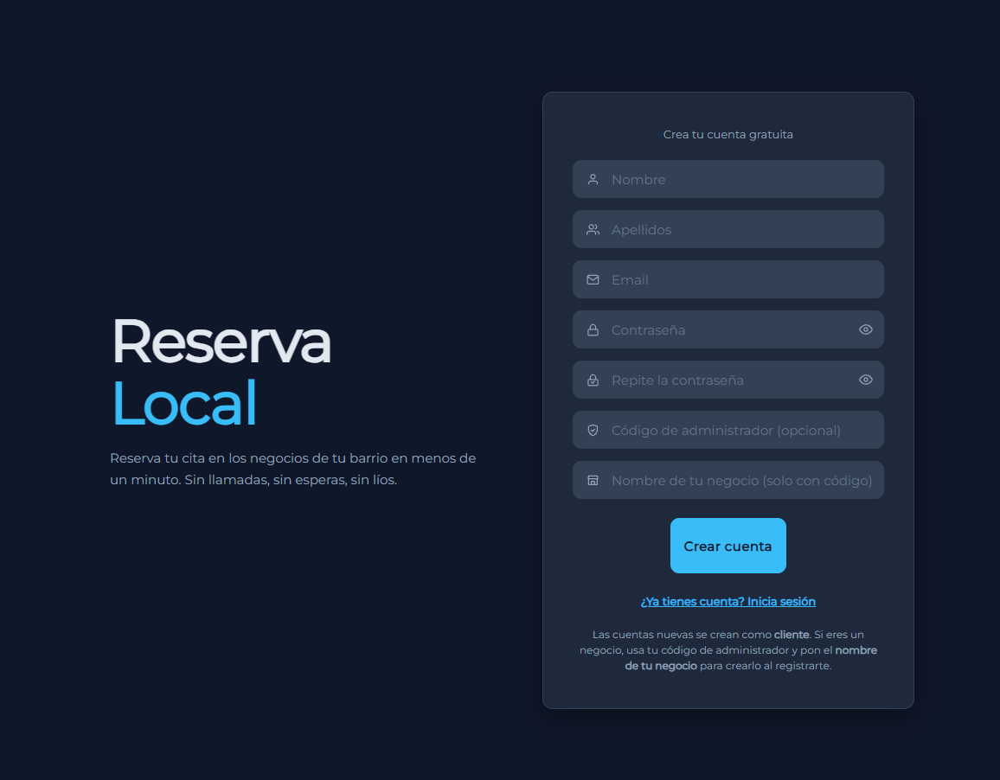

## Flujo del cliente

### Elegir un negocio

Tras iniciar sesión como cliente, llegas a la pantalla inicial del cliente, una pantalla que muestra las reservas actuales y dos botones de "Hacer una reserva" y "Cerrar sesión".

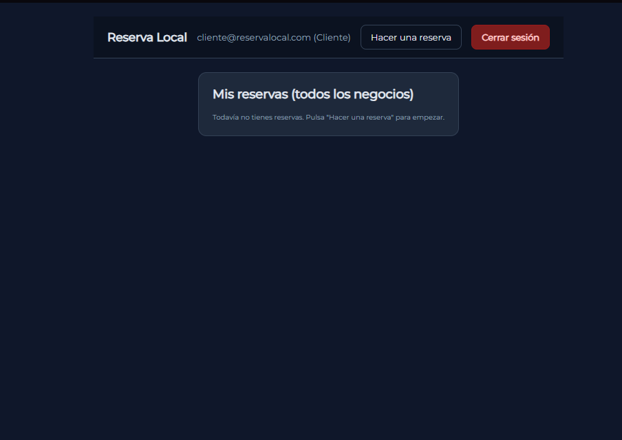

Al pulsar en el boton de "Hacer una reserva" aparecera un selector con tarjetas de los negocios disponibles. Cada tarjeta muestra el icono del negocio (si lo tiene) y su nombre. Pulsa sobre la que quieras para entrar.

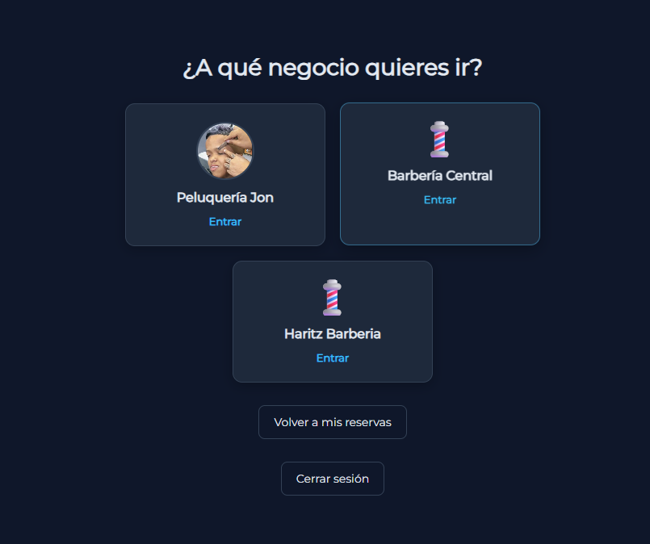

El usuario tiene la opcion de volver a sus reservas si asi lo desea con un boton debajo de los negocios al igual que si quisiese cerrar la sesion dispondria de otro boton para ello.

### Hacer una reserva

Dentro de un negocio verás un formulario con tres pasos:

1. **Servicio**: un desplegable con todos los servicios que ofrece el negocio, su precio y si ya lo tienes reservado (aparecerá en gris con el texto "ya reservado").
2. **Día**: un calendario que solo permite elegir fechas desde hoy hasta dentro de un mes.
3. **Hora disponible**: un desplegable con las horas libres de ese día concreto.

Cuando tengas los tres campos rellenos, pulsa **Reservar**. Si todo está correcto, vuelves al selector de negocios con un mensaje de confirmación arriba.

Los servicios que ya tienes reservados en ese negocio aparecen deshabilitados: no puedes tener dos reservas activas del mismo servicio a la vez. Para volver a pedirlo, primero cancela la que tienes.

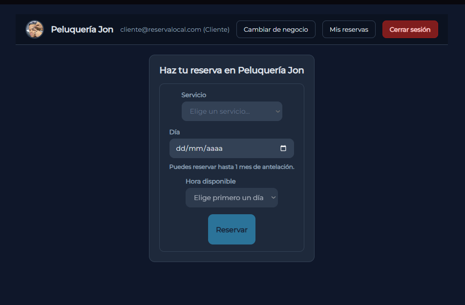

### Ver y gestionar tus reservas

En la barra superior tienes el botón **Mis reservas**, que te lleva a una lista con todas tus citas de todos los negocios, agrupadas por nombre del negocio.

Cada reserva muestra el nombre del servicio, tu nombre, la fecha (en formato día/mes/año) y el estado (pendiente, confirmada o cancelada).

Según el estado, verás distintos botones:

- **Si está pendiente o confirmada**: puedes **Cambiar hora** (se abre un selector para elegir otro día y hora; al guardar vuelve a pendiente para que el admin la confirme) o **Cancelar reserva** (la marca como cancelada tras pedir confirmación).

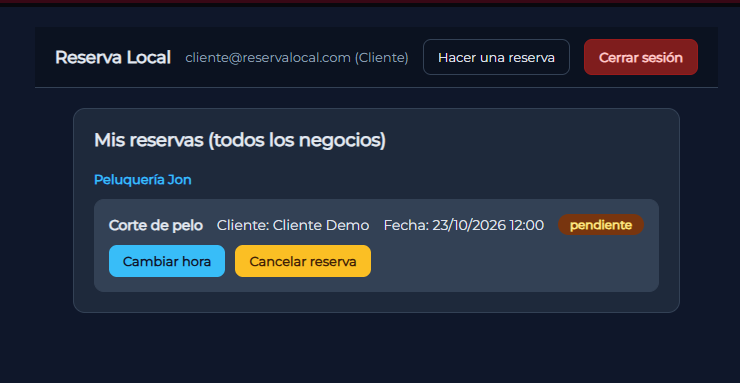

- **Si está cancelada**: puedes **Eliminar** (la borra del todo de tu lista tras pedir confirmación).

Las reservas canceladas no desaparecen solas: puedes dejarlas como histórico o eliminarlas cuando quieras.

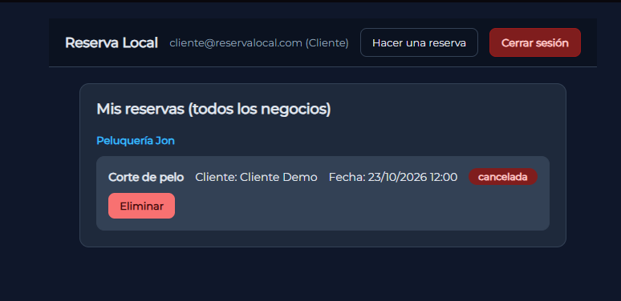

## Flujo del administrador

### Entrar en tu negocio

Tras iniciar sesión como admin, llegas directamente al panel de tu negocio. En la barra superior verás el icono de tu negocio, su nombre, tu email y los botones de cerrar sesión.

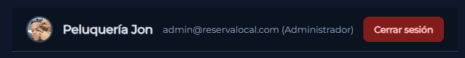

### Ver la agenda

La sección **Agenda del negocio** muestra todas las reservas de tu negocio. Arriba tienes dos filtros:

- **Buscador de texto**: filtra por cliente, fecha o servicio mientras escribes.
- **Filtro de estado**: muestra solo las reservas de un estado concreto (pendiente, confirmada, cancelada o todos).

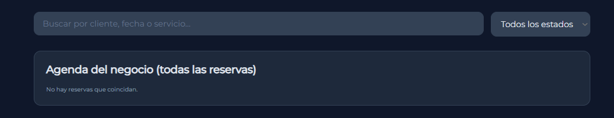

Cada reserva muestra el servicio, el cliente, la fecha y el estado. Según el estado, tienes distintos botones:

- **Pendiente**: **Confirmar** (la pasa a confirmada) o **Cancelar** (la pasa a cancelada).

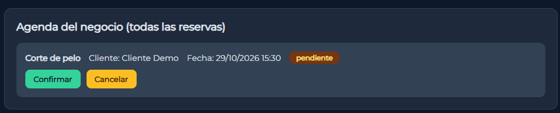

- **Confirmada**: solo **Cancelar**.

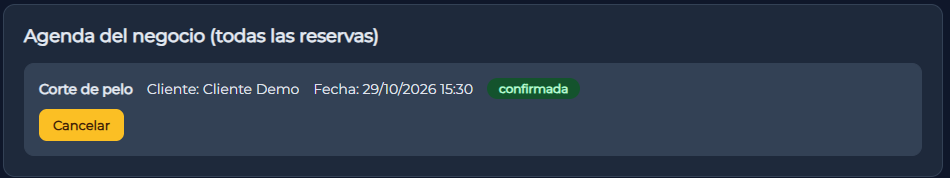

- **Cancelada**: **Confirmar** (la reactiva como confirmada) o **Eliminar** (la borra del todo).

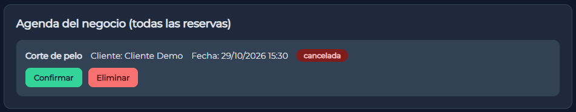
  

El administrador no puede cambiar la fecha de una reserva del cliente: solo gestiona el estado. Si el cliente quiere otra hora, debe cambiarla él mismo desde su lista.

### Gestionar los servicios

En **Servicios del negocio** ves la lista actual con el nombre y el precio de cada uno. Para cada servicio puedes:

- **Editar**: cambia el nombre o el precio en línea y pulsa **Guardar**.
- **Eliminar**: borra el servicio del todo.

Abajo tienes un formulario para añadir servicios nuevos: escribe nombre y precio, y pulsa **Crear servicio**.

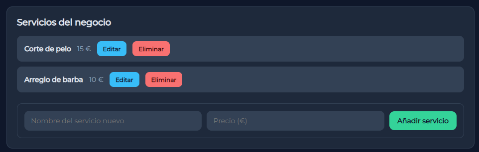

### Configurar el horario semanal

En **Horario semanal del negocio** ves una fila por cada día de la semana. Para cada día puedes:

- Marcar o desmarcar el checkbox **abierto/cerrado**.
- Si está abierto: definir la hora de apertura, la hora de cierre y el intervalo entre citas (en minutos, entre 5 y 240).

Al final, pulsa **Guardar semana**. Las horas disponibles que ve el cliente se generan automáticamente según este horario.

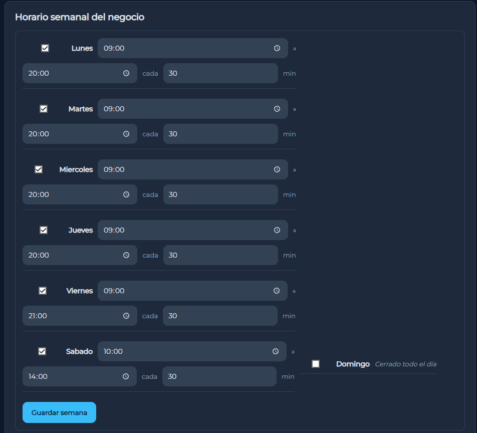

### Perfil del negocio

En **Perfil del negocio** puedes:

- **Cambiar el nombre**: edita el texto y pulsa **Guardar nombre**.
- **Subir un icono**: elige una imagen cuadrada (png, jpg, gif o webp, máximo 5 MB) y pulsa **Subir icono**. Aparecerá en la barra superior y en el selector de negocios.
- **Quitar el icono**: si ya tienes uno, pulsa **Quitar icono** para volver al icono por defecto.

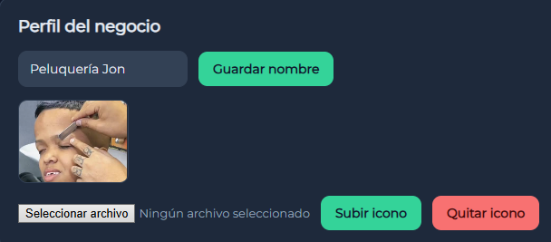

## Reglas que debes conocer

- **No se puede reservar en el pasado**: el sistema no permite elegir días ni horas que ya pasaron.
- **Tope de un mes**: el cliente solo puede reservar con un mes de antelación como máximo.
- **Un servicio por cliente**: cada cliente solo puede tener una reserva activa (pendiente o confirmada) de cada servicio en cada negocio.
- **Horas únicas**: una misma hora no puede reservarse dos veces. Si el cliente intenta reservar una hora ya ocupada, el sistema le avisa.
- **El admin no mueve fechas**: el administrador solo confirma, cancela o elimina. Si el cliente quiere otra hora, la cambia él mismo.
- **Códigos de un solo uso**: en un entorno real, los códigos que permiten crear negocios los emite ReservaLocal al dar de alta un nuevo negocio. El código `1234` es solo para pruebas.

## Observaciones

- Tras hacer una reserva, vuelve al selector de negocios para poder reservar en otro sitio o ver tus citas en **Mis reservas**.
- Si quieres limpiar tu lista, cancela primero las reservas activas y luego elimínalas cuando aparezcan como canceladas.
- El administrador ve en tiempo real cualquier cambio que haga el cliente (cambio de hora, cancelación).